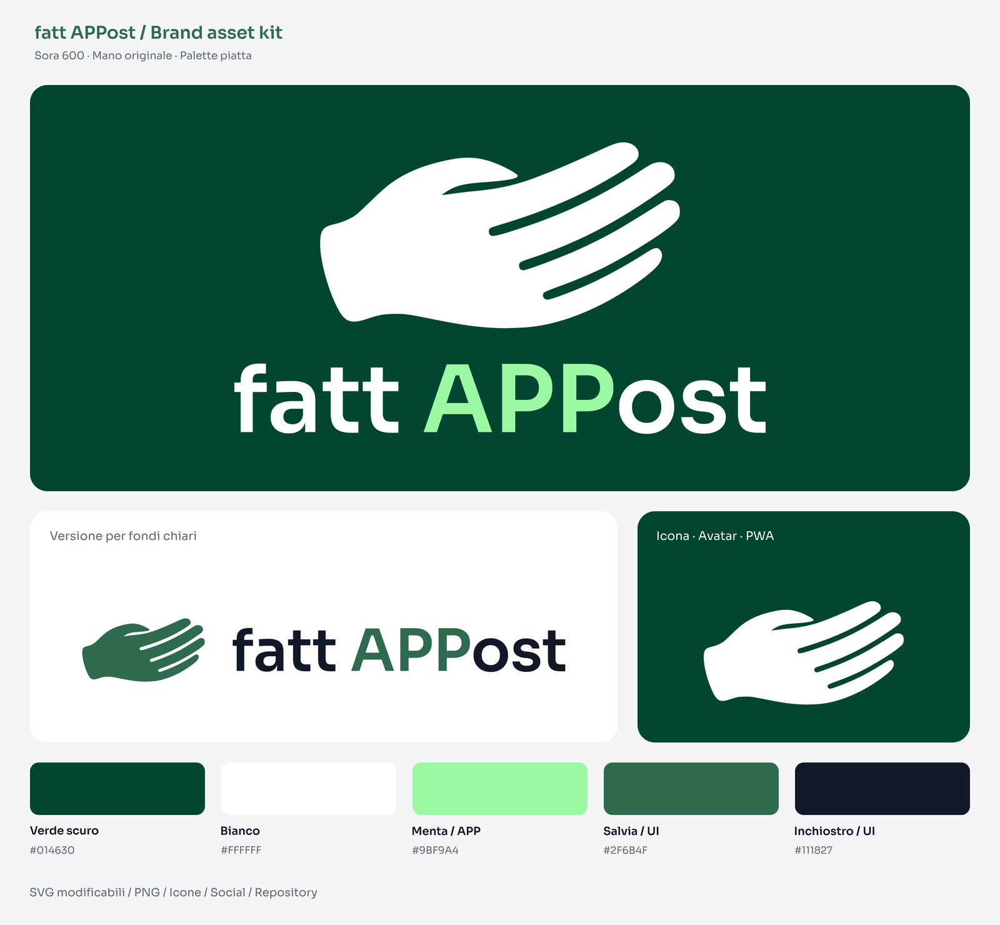

# fatt APPost — Brand asset kit

Mano aperta originale, senza stellina. Wordmark **fatt APPost** in **Sora SemiBold 600**, con **APP** verde menta e le altre lettere bianche su verde scuro. Versione 1.0 · 15 novembre 2026.



## Parti da questi file

| Utilizzo | File |
| --- | --- |
| Logo principale, sfondo verde | `assets/brand/svg/logo-stacked-dark.svg` |
| Logo principale, PNG 2048 px | `assets/brand/png/logo-stacked-dark-2048.png` |
| Logo trasparente per fondi scuri | `assets/brand/svg/logo-stacked-reverse.svg` |
| Logo trasparente per fondi chiari | `assets/brand/svg/logo-stacked-on-light.svg` |
| Header dell’app o del sito | `public/brand/logo-horizontal-on-light.svg` |
| Wordmark senza mano | `assets/brand/svg/logo-wordmark-reverse.svg` |
| Mano isolata | `assets/brand/marks/hand-white.svg` |
| Modifica del testo | `sources/logo-stacked-editable.svg` |
| Avatar social | `marketing/avatar/avatar-1024.png` |
| Condivisione dei link | `public/og-image.png` — 1200 × 630 px |
| Favicon | `public/favicon.svg`, `public/favicon.ico` |
| Icone e manifest PWA | `public/icons/`, `public/site.webmanifest` |

`reverse` significa sfondo trasparente, mano bianca, testo bianco e APP menta: va su un fondo scuro. `on-light` usa mano e APP salvia, testo inchiostro, per i fondi chiari dell’app. `dark` include il fondo verde scuro. Le versioni `mono-*` sono trasparenti e a un solo colore.

## Contenuto

```text
fatt-appost-brand-kit/
├── README.md
├── assets/brand/
│   ├── svg/                 # Verticale, orizzontale e solo wordmark; 6 varianti
│   ├── png/                 # PNG trasparenti, con fondo e monocromatici
│   ├── marks/               # Mano isolata in 4 colori e currentColor
│   ├── brand.css            # Variabili CSS del marchio
│   └── tokens.json          # Colori e tipografia del marchio
├── public/                  # File pronti da copiare nel public della repo
│   ├── brand/               # Loghi SVG per l’interfaccia
│   ├── icons/               # PWA any e maskable: 192 e 512 px + SVG
│   ├── favicon.svg
│   ├── favicon.ico          # 16, 32 e 48 px nello stesso file
│   ├── favicon-*.png        # 16, 32, 48 e 96 px
│   ├── apple-touch-icon.png # 180 × 180 px
│   ├── safari-pinned-tab.svg
│   ├── site.webmanifest
│   └── og-image.png         # 1200 × 630 px
├── marketing/
│   ├── avatar/              # 512 e 1024 px; anche circolare trasparente
│   ├── og/                  # Due composizioni, PNG + SVG
│   └── social/              # Post, story, banner, anteprima repository
├── fonts/                   # Sora variabile TTF + WOFF2 + licenza OFL
├── sources/                 # Master con testo editabile e riferimenti originali
├── docs/                    # Linee guida, geometrie e verifica di centratura
├── examples/                # HTML e componente React/Next.js
├── preview/                 # Tavola riepilogativa e galleria offline
└── scripts/                 # Rigenerazione e controllo degli export
```

### Risoluzioni

- Logo verticale: 1024 × 1024 e 2048 × 2048 px.
- Logo orizzontale: 1600 × 400 e 3200 × 800 px.
- Solo wordmark: larghezze 1600 e 3200 px, altezza proporzionale arrotondata al pixel.
- Le varianti monocromatiche sono esportate alla risoluzione maggiore.
- Avatar: 512 × 512 e 1024 × 1024 px; circolare trasparente 1024 × 1024 px.
- Open Graph: 1200 × 630 px, composizione verticale e orizzontale.
- Post: 1080 × 1080 px; story: 1080 × 1920 px; banner: 1584 × 396 px.
- Anteprima repository: 1280 × 640 px.
- Tutte le tavole marketing hanno anche un SVG modificabile.

## Integrazione nella repo

1. Copia il contenuto di `public/` nel `public/` della tua applicazione. Se esistono già un manifest o icone, unisci i campi pertinenti del manifest e aggiorna i riferimenti.
2. Conserva `assets/brand/`, `sources/`, `fonts/` e `docs/` in `design/brand/` o `docs/brand/` per tenere i master sotto controllo di versione.
3. Usa il logo `on-light` sui fondi `#f4f5f7` e bianchi dell’app; usa `reverse` su una superficie scura.
4. Aggiungi favicon e metadati usando gli esempi in `examples/`. Per OG inserisci l’URL assoluto del tuo dominio dove indicato.

Per un’app pubblicata sotto un sottopercorso, adatta i percorsi HTML e del componente. Nel manifest `./` identifica la cartella che contiene il manifest: verifica `id`, `start_url` e `scope` per la tua installazione.

Il manifest usa **#f4f5f7** per `theme_color` e `background_color`, come previsto da `DESIGN.md`. Le icone mantengono il fondo verde scuro del marchio. Il kit fornisce le risorse grafiche e il manifest; l’app gestisce il proprio funzionamento offline.

Nel README della tua repository puoi usare un percorso relativo, per esempio:

```html
<p align="center">
  
</p>
```

Adatta il percorso alla cartella in cui hai conservato il kit.

## File modificabili e font

Gli SVG di produzione contengono **tracciati vettoriali reali**: mano e lettere sono forme modificabili, senza bitmap incorporate e senza dipendenza da font installati. Puoi aprirli in Figma, Illustrator o Inkscape e modificare i nodi o i colori.

I tre master in `sources/*-editable.svg` conservano invece la scritta come testo. Incorporano Sora WOFF2 per i browser. Per modificare il testo in un editor desktop, installa `fonts/Sora-Variable.ttf`, seleziona **Sora / SemiBold / 600** e conserva le tre parti `fatt `, `APP`, `ost`. La spaziatura è basata sulle metriche di Sora; dopo un cambio di testo occorre ricentrare il wordmark.

Il file TTF e il WOFF2 includono la famiglia Sora completa, senza ricorrere a CDN. Non serve caricare Sora nell’interfaccia se usi i loghi a tracciati. Poppins resta il font dell’interfaccia indicato dal design system; non è incluso in questo kit.

Sora proviene dalla [raccolta ufficiale Google Fonts](https://github.com/google/fonts/tree/main/ofl/sora). La licenza è inclusa in `fonts/OFL.txt`; le condizioni riguardanti l’uso e la redistribuzione del font sono contenute in quel file. Non viene assegnata una nuova licenza al marchio o all’immagine fornita dall’utente.

## Centratura e palette

La centratura usa i **limiti visibili dei tracciati**, senza includere spazi invisibili del font. Nella composizione verticale, mano e wordmark hanno entrambi asse X = 600 su una tavola da 1200 px; il loro ingombro complessivo è centrato anche verticalmente. Nella composizione orizzontale, i due elementi condividono l’asse Y = 160.

I valori esatti sono in `docs/geometry.json`. Apri `docs/centering-proof.svg` per vedere assi e ingombri sovrapposti al logo.

| Ruolo | Colore |
| --- | --- |
| Fondo del marchio | `#014630` |
| Mano e lettere principali | `#FFFFFF` |
| APP su fondo scuro | `#9BF9A4` |
| Mano e APP sui fondi chiari | `#2F6B4F` — salvia di DESIGN.md |
| Lettere sui fondi chiari | `#111827` — inchiostro di DESIGN.md |

Verde scuro e menta sono campioni piatti ricavati dal logo fornito. La texture e le piccole variazioni di colore del PNG non vengono riprodotte nei master. Il documento `sources/DESIGN.md` è conservato com’è: la richiesta corrente definisce il marchio **fatt APPost**, Sora e la combinazione verde/bianco/menta; il design system continua a governare l’interfaccia.

Vedi `docs/BRAND-GUIDELINES.md` per spazio di rispetto, dimensioni minime e scelta delle varianti.

## Controllo e rigenerazione

Gli export sono già pronti: non occorre installare nulla per usarli. Per rigenerarli occorrono Python 3.10+ e Node 20.9 o successivo.

```sh
python3 -m pip install -r requirements.txt
npm install
npm run build
```

La procedura ricalca la mano dal riferimento, imposta Sora a 600, genera gli SVG, renderizza i PNG e verifica geometrie, dimensioni, trasparenza e area sicura maskable. `docs/validation.json` contiene l’esito dell’ultimo controllo; `MANIFEST.json` e `SHA256SUMS.txt` elencano i file distribuiti.

Per un’ispezione senza collegamento a Internet, apri `preview/index.html` oppure `preview/brand-kit-overview.png`.
